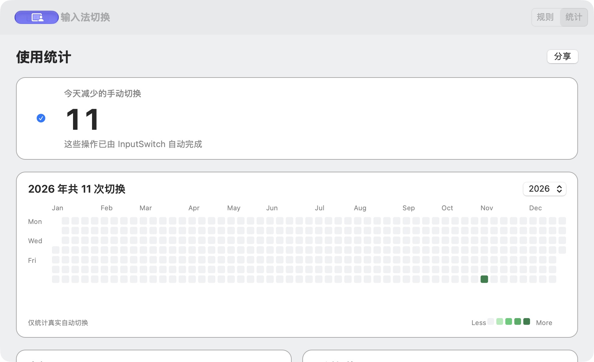

# InputSwitch

进入应用，自动切换到你常用的输入法。

InputSwitch 是一个原生 macOS 小工具：为每个应用指定输入法，切换应用时自动生效，无需反复手动切换。



## 功能

- 为每个应用指定输入法，例如让 VS Code 使用 ABC，让微信使用中文输入法。
- 点击规则中的输入法即可重新选择，也可随时暂停自动切换。
- 通过年度热力图、高频 App 和最近切换记录查看使用效果；鼠标停在格子上可查看当天详情。
- 无第三方依赖，支持登录时启动；可从 Dock、应用切换器或菜单栏返回。

## 安装与启动

目前请从源码构建，需要 macOS 13 或更高版本，以及 Swift 命令行开发工具。

```bash
git clone https://github.com/yl-jiang/InputSwitch.git
cd InputSwitch
make build
open dist/InputSwitch.app
```

如果系统提示缺少命令行开发工具，先运行 `xcode-select --install`，再执行上述构建命令。构建好的应用位于 `dist/InputSwitch.app`，也可移动到「应用程序」文件夹。

## 使用

1. 点击「添加规则」，选择应用和对应的输入法。已有规则可直接点击输入法列修改。
2. 切换到已配置的应用，InputSwitch 会在需要时自动切换输入法。可通过窗口或菜单栏图标暂停。
3. 打开「统计」查看切换次数、年度分布和最近记录；需要时勾选「登录时启动」。
4. 关闭窗口不会退出应用。可从 Dock 或应用切换器重新打开，也可通过菜单栏图标退出。

## 隐私

规则和统计仅保存在本机，不记录输入内容，也不会自动上传。统计数据位于 `~/Library/Application Support/InputSwitch/switch-events.jsonl`；只有主动点击「分享」才会交给系统分享服务。

## 开发与贡献

运行 `make test` 执行测试。欢迎通过 [Issues](https://github.com/yl-jiang/InputSwitch/issues) 反馈问题，或提交 Pull Request 改进项目。
